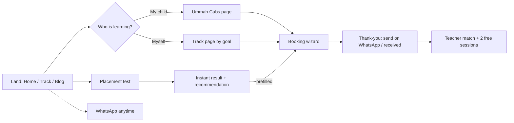

# Audit · UX & user flows

## 1. Information architecture

**v1 navigation:** Courses ▾ · Teachers · Pricing · Family Portal · About · Blog · [Sign in] [Book free trial]

| Issue | Impact | v2 |
|---|---|---|
| "Family Portal" sits in primary navigation | It serves existing customers and dilutes acquisition navigation | Moves to the footer and the Sign-in link; kids page explains it |
| No language switch | Arabic speakers have no path | `العربية` / `English` switch, path-aware |
| No obvious "for kids" entry | The largest segment must hunt inside the mega-menu | Mega-menu promotes "For kids 5–14"; home router card |
| Placement test only in the mega-menu aside | Undecided users miss it | Secondary CTA in the hero and on track pages |

**v2 primary navigation:** Courses ▾ (4 tracks + compare + placement test) · Teachers · Pricing · About · Blog · `العربية` · Sign in · **[Book free trial]**

## 2. Core journeys

### Journey friction found in v1

| Step | Friction | v2 fix |
|---|---|---|
| Home → decide | 15 sections; no routing by learner | Router card right after the hero |
| Track page → act | CTA buried; two FAQ blocks; filler blocks | At-a-glance panel with price + CTA above the fold; one FAQ |
| Booking | 5 required fields at once; selects are fiddly on mobile; form below 6 sections | 3-step wizard at the top of `/contact/`; tap tiles; country guessed from timezone |
| Placement test | Self-rating step, then a WhatsApp gate | Straight into questions; instant result; optional share |
| Pricing | 7 cards; no guidance | Plan finder plus a clear "30 vs 60 minutes" rule |
| Mobile | No persistent action after the hero | Sticky action bar |
| Arabic speakers | No Arabic experience beyond decorative sub-lines | Full RTL `/ar/` funnel |

## 3. Booking wizard specification (v2)

1. **Who & what.** Learner: *Me* / *My child* / *Me and my child(ren)*. Course: tiles grouped by track, preselected from context (`?course=`, placement result).
2. **When & how.** Days (Weekdays / Weekends / Flexible), time window (Morning / Afternoon / Evening / Flexible), teacher preference (No preference / Female / Male). The timezone is auto-detected and shown.
3. **Your details.** First name, WhatsApp number (with country code hint), country (auto-guessed from timezone, editable), email (optional), notes (optional).

Then:

- Validation is inline and per step. Progress shows "Step 1 of 3". The Back button keeps the user's answers.
- On submit, the optional webhook receives the payload plus UTM attribution, and the user goes to `/thank-you/`. That page is explicit about state: either *received* or *send on WhatsApp to confirm*.

## 4. Mobile ergonomics

- Tap targets are ≥ 44 px; choice tiles replace selects where the list has 6 options or fewer.
- The sticky action bar appears after 70% of the hero has scrolled out of view. It hides when the footer is in view and on `/contact/` and `/thank-you/`.
- The header condenses on scroll, and the menu sheet is a native `<dialog>` with focus trap and Esc support.

## 5. Accessibility of flows

- Every wizard step has a `<fieldset>`/`<legend>`. Focus moves to the step heading on navigation, and the progress text sits in an `aria-live` region.
- The placement test announces the result in an `aria-live` region; options are radio inputs (arrow-key navigable).
