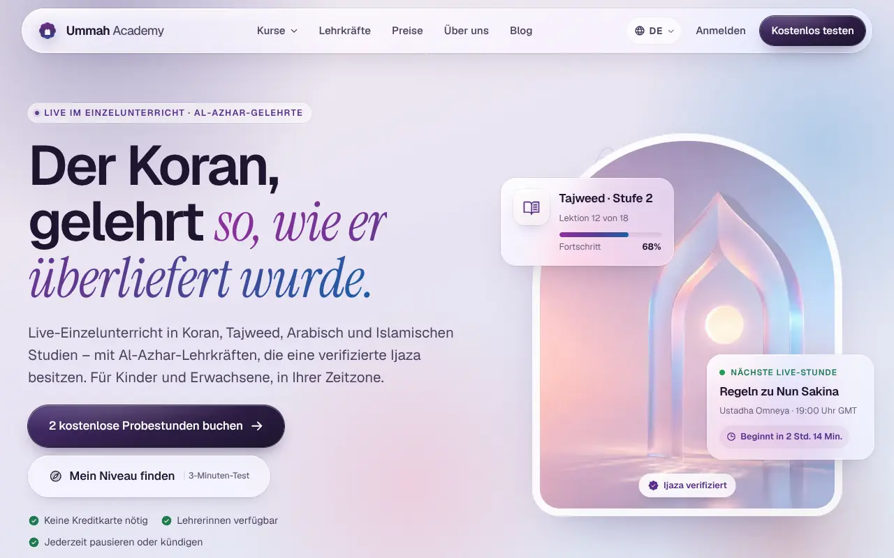
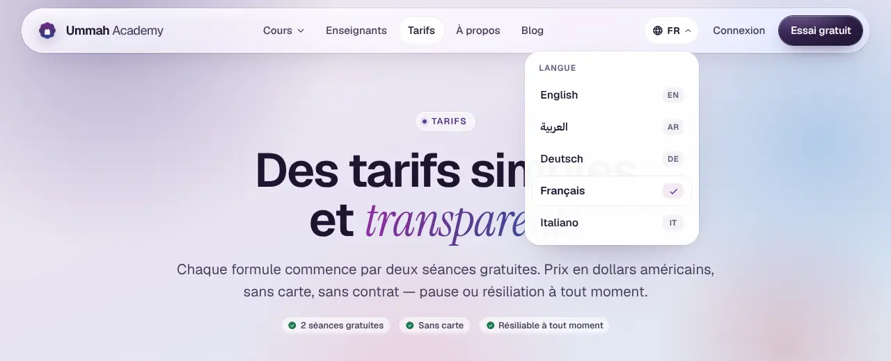
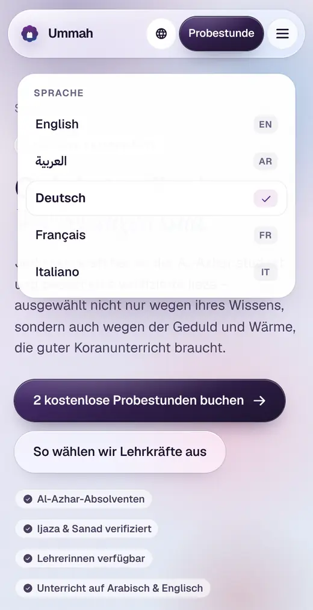
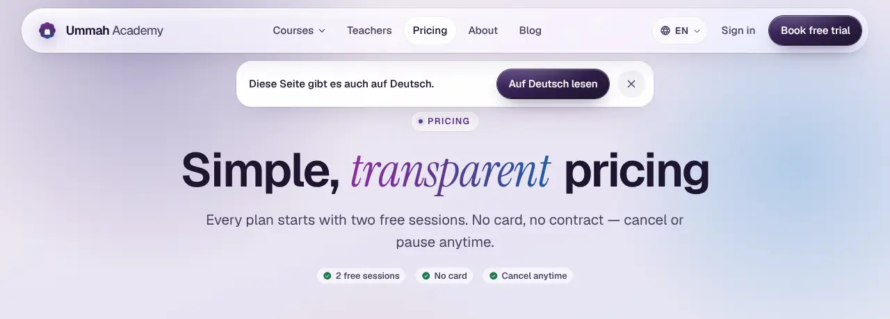
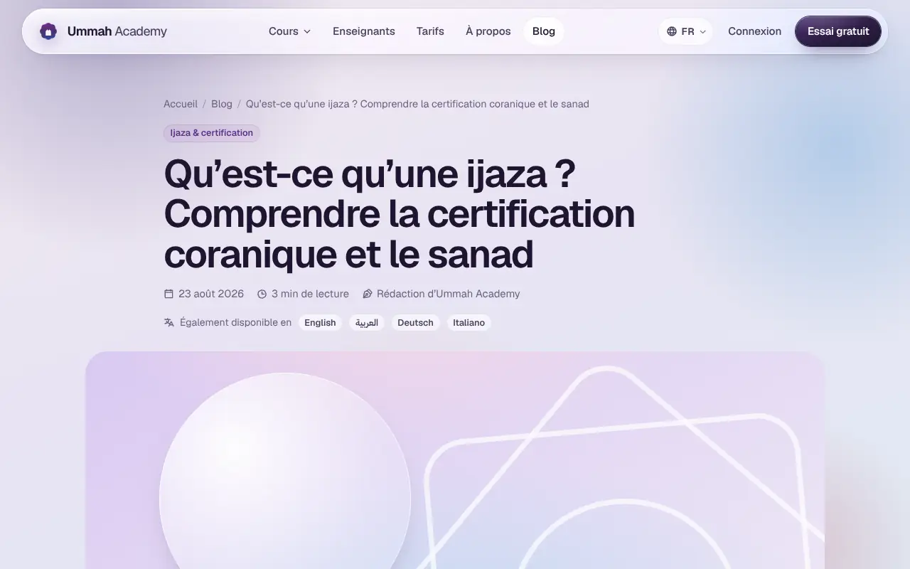
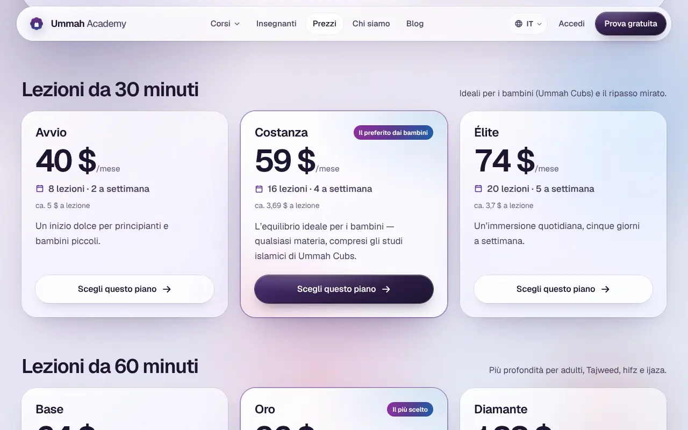
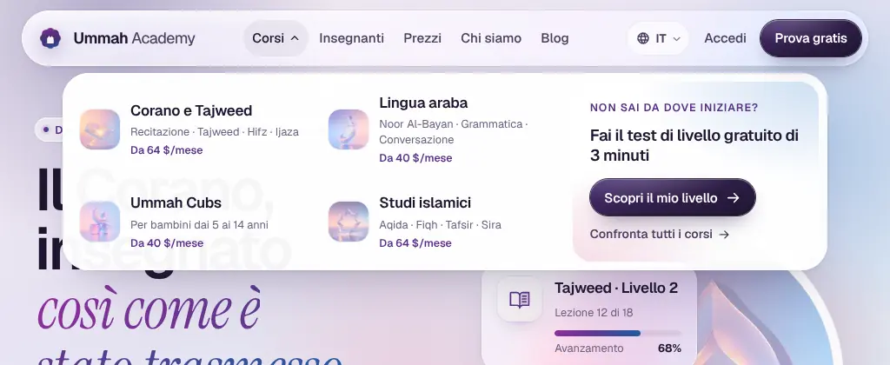

# 12 · Phase 4 changelog: the whole site in German, French and Italian

> **Plan:** [`10-phase4-i18n-plan.md`](10-phase4-i18n-plan.md), written before any code. **Terminology:** [`11-i18n-glossary.md`](11-i18n-glossary.md).
>
> **The ask (15 Oct 2026), translated:** "+971 50 276 0242 is the WhatsApp number" and "I need the whole site translated, with a language switch for German, French and Italian. Go for it."
>
> **Commits on `arena/8f0d374d-ummah-academy`:**
>
> | Commit | Scope |
> |---|---|
> | `0512d6e` | W0–W2: engine and extraction |
> | `8aac687`, `45a5d88` | W3: views |
> | `cc975e8` | W4: data |
> | `cbcb0ba` | Legal, 404 and the i18n checker |
> | `e10e06b`, `1fa132e`, `5387f9c`, `fdf3b77` | W5: 57 articles |
> | `3db9132` | W6: OG cards, consent, Impressum gate, strict builds |
> | `1f122cb` | W7: QA fixes |
>
> The docs follow in the next commit.
>
> **Rule kept from Phases 1–3:** the site states nothing the academy hasn't published. Where a translation could imply something new (lessons in German, EUR prices, a German legal entity), the site says the honest thing and the decision goes to Linear.

## 1. At a glance

| | Phase 3 | Phase 4 |
|---|---|---|
| Languages | 2 (EN, AR) | **5**: English at `/`, Arabic (RTL) at `/ar/`, **German** at `/de/`, **French** at `/fr/`, **Italian** at `/it/` |
| Pages built | 69 | **195**: 23 routes × 5 languages, plus 19 EN, 3 AR and **57 DE/FR/IT** articles, plus the 404 |
| Words translated | — | **About 65,000**: DE ~20k, FR ~23k, IT ~22k (page copy + data + articles) |
| Language switch | EN ↔ AR toggle | **Glass language menu**: header popover, phone sheet, footer row. It always opens the true translation and never a 404 |
| Language hint | — | A dismissible hint **in the visitor's own language** ("Diese Seite gibt es auch auf Deutsch."). It never redirects |
| hreflang | 23 mirrored routes + 3 article pairs | **189 reciprocal clusters** (+ `x-default`), checked after every build |
| RSS feeds | 1 | **5** (`/rss.xml`, `/ar/rss.xml`, `/de/rss.xml`, `/fr/rss.xml`, `/it/rss.xml`) |
| OG cards | EN, AR | **EN, AR, DE, FR, IT** |
| Internal links checked | 5,078 | **16,907**, 0 broken |
| axe violations | 0 / 68 pages | **0 / 194 pages**, plus the open menu, hint and mega-menu states |
| Overflow sweep | 390/1440 px | **320/360/768/1024/1280 px × 194 pages**, 0 overflow |
| Header fit | 360/390/430 px (EN, AR) | **Every width from 320 to 1440 px × 5 languages** (5,605 layouts) |
| Lighthouse (mobile) | Perf 88–99 · 100 · 100 · 100 | **Perf 87–99 · A11y 100 · BP 100 · SEO 100**. No regression on EN/AR |
| JS per page (gz) | ~1.9 KB site + islands | ~1.8 KB site. Placement JS **4.2 → 2.2 KB** and booking **2.7 → 2.4 KB**, because their strings now ship as page JSON |

## 2. How it works

| Piece | Where | What it does |
|---|---|---|
| **Locale registry** | `src/i18n/index.ts` | One `LOCALE` table: native name, `dir`, `Intl` tag, OG locale, URL prefix and pill label. `LANGS` sets the menu order (EN, AR, then the European locales). The module has no dependencies. |
| **URLs** | `src/pages/[locale]/` | EN stays at the WordPress URLs. AR/DE/FR/IT reuse the **same slugs** under a prefix (`/de/pricing/`). One `[locale]` route set serves all four languages, so the 22 duplicated `pages/ar/*` wrappers are gone. |
| **Routing helpers** | `src/i18n/index.ts` | `lp(lang, path)` localises a path (untranslated paths stay English). `langFromPath`, `basePath`, `mirrorAlternates`, and `langTargets` (the menu targets: the true translation, or the closest section with `exact: false`). |
| **Copy** | `src/locales/<lang>/` | 23 modules per language (`ui`, `home`, `pricing`, `booking`, …). **English is the typed reference.** A build-time check compares every locale's shape (keys, array lengths and value types) and fails the build on any difference. |
| **Data text** | `src/locales/{de,fr,it}/data/` | Text-only overlays for tracks and courses, track pages, teachers and testimonials, plans, the placement test and legal. Ids, prices, links and images stay in **one** place (`src/data/*`), so prices can't drift between languages. |
| **Blog** | `src/content/blog-tr/<lang>/` | The `blogTr` collection. Each file has a localised slug and a **required** `translationOf` (the English slug), so every article's cluster (EN, AR?, DE, FR, IT) is computed once and is reciprocal by construction. |
| **Formatting** | `src/i18n/index.ts` | `price()` gives `$40`, `٤٠ $` or `40 $` (NBSP). `pct()` gives `65 %` in DE/FR and `65%` in IT. `fmtDate()` uses `Intl`. Country names come from `Intl.DisplayNames`, with Austria, Switzerland and Luxembourg added. |
| **SEO** | `src/layouts/BaseLayout.astro` | `hreflang` for every real translation + `x-default` (EN), `og:locale` + `og:locale:alternate`, a localised OG card, localised JSON-LD (breadcrumbs, FAQ, courses, profiles, articles), and a five-locale sitemap. `noindex` pages emit no hreflang. |
| **Strictness** | `src/locales/index.ts` | A production build **throws** if a locale is missing a module. `astro dev` renders missing modules in English and warns. `I18N_LENIENT=1` and `I18N_STRICT=1` override this. |
| **Post-build guard** | `scripts/check-i18n.mjs` (`npm run check:i18n`, part of `npm run qa`) | Checks `<html lang>`/`dir` against the URL, self-canonicals, and reciprocal hreflang clusters (every alternate exists, lists the same set, includes itself and has an `x-default`). An **English-leak detector** fails on any English sentence visible on a DE/FR/IT page, including alt, aria-label, title, placeholder and meta description. |

## 3. What was built, workstream by workstream

### W0 · Contact

- **+971 50 276 0242 is marked confirmed** in `src/data/site.ts`, in the launch checklist and in Linear ABO-37.
- The e-mail domain and the address are still open (ABO-37). The address is now also needed for the Impressum (ABO-51).

### W1 · Extraction (proven no-op)

- All EN and AR copy moved out of views and components into `src/locales/{en,ar}`.
- The **EN and AR page bodies were diffed before and after: byte-identical**. The refactor changed nothing a visitor could see.

### W2 · Engine and language UX

- **Language menu** (`src/components/LangMenu.astro`), one component in three placements:
  - **Header:** a frosted `
` popover with native names, the current language ticked, and `lang`/`hreflang` on every link. Below 860 px it becomes a fixed sheet so it can never run off a phone screen in RTL.
  - **Mobile menu:** five chips.
  - **Footer:** a row of language names.
- **Behaviour:**
  - The menu works without JavaScript. JS only adds outside-click, Escape and one-open-at-a-time.
  - When a page has no exact translation, the menu says so in one line and opens the closest section.
  - An explicit choice is remembered (`localStorage`), so the hint never nags again.

  

  
- **Language hint** (`LangHint.astro` + `site.ts`):
  - **When it shows:** only when the browser prefers a language that has a translation of *this* page.
  - **What it says:** it is written in that language, so a German reader on an English page reads German.
  - **What it never does:** redirect, which keeps crawlers and shared links safe.
  - **Accessibility:** it uses `lang`/`dir` for screen readers and has an accessible close button.

  
- **German typography:** `hyphens: auto` on `:lang(de)` headings and text for compounds such as *Einstufungstest* and *Datenschutzerklärung*, with `overflow-wrap` as a safety net.

### W3 · Every page and component ×3

- **Translated surfaces:**
  - UI strings and the home page;
  - courses and the five track pages;
  - pricing and the plan finder;
  - teachers and the 3 profiles;
  - about, contact and the **booking wizard**;
  - the **placement test**;
  - FAQ, career, thank-you, resources, the family portal, the blog index, the article chrome, the consent banner and the 404.
- **Register:** DE *Sie*, FR *vous*, IT *tu*.
- **Typography:** DE `„…“`; FR `« … »` with no-break spaces before `? ! : ;`; IT `«…»`. Figures follow local style: `1.000+` (DE/IT), `1 000+` (FR), `95 %` (DE/FR), `95%` (IT).
- **The 404** is one static file for every missing URL, so it carries all five languages. An inline script puts the visitor's path language first, next to English.

### W4 · Data ×3

The data overlays cover:

- tracks and courses, the five course pages (curriculum, outcomes, FAQs), teachers and credentials, and the plans;
- the **placement-test question bank** (answers and levels unchanged);
- **testimonials**, labelled "translated from English" in each language;
- Privacy and Terms, as convenience translations stating that **the English text prevails** (ABO-44).

### W5 · Blog ×3

- **All 19 articles in DE, FR and IT: 57 translations.**
  - Each has a slug in the target language that carries the terms people actually search.
  - The full slug map is in glossary §6.
- **What every article page gets:**
  - an "Also available in …" row linking its twins;
  - related posts in the same language;
  - one RSS feed per language.
- **Religious content:**
  - The articles render the **meaning** of the vetted English.
  - No verse or hadith is quoted in the sources, and none was added.
  - Review is tracked in ABO-39 and ABO-52.
- **One honesty fix in English:** the EN parents' guide now matches the site's recordings claim ("available on request").

### W6 · Scripts, consent, legal and OG

- **Booking wizard:**
  - Validation and step labels are in the visitor's language.
  - The WhatsApp message is written in that language and ends with a bilingual line, e.g. **`Sprache / Language: Deutsch (de)`** or `Langue / Language : français (fr)`, so the team knows how to reply.
  - The lead payload carries `lang`. The country stays in English for operations.
- **Placement engine:** reads its strings from page JSON (`#pt-i18n`).
- **Consent banner:** "No thanks" and "Allow" now have **equal visual weight** in every language, because EU regulators expect refusing to be as easy as accepting.
- **Impressum / legal notice** (`src/pages/[...imprint].astro`):
  - It renders `/legal-notice/` in all five languages, plus a footer link, **only** when `SITE.legalEntity` holds real company data. We never publish placeholders.
  - It was tested with temporary data (5 pages, a valid hreflang cluster) and then reverted. The data request is ABO-51.
- **OG cards:** `public/og/default-{de,fr,it}.png` (1200×630) in each language.
- **Strict production builds:** a half-translated locale can't ship.

## 4. Honesty and positioning decisions

| Topic | What the site does now | Why / who decides |
|---|---|---|
| Language of lessons | Every DE/FR/IT page that touches the topic says lessons are in **Arabic and English**, e.g. "Unterricht auf Deutsch bieten wir derzeit nicht an". JSON-LD reads `SITE.teachingLanguages` | Competitors sell teachers who speak the family's language. Implying that would be false. **ABO-50** |
| Prices | **USD**, written the local way (`40 $`), and the pricing page says "in US dollars" | EUR/CHF display is a business call. **ABO-43** |
| Testimonials | Shown in translation, labelled as translated | They were given in English |
| Legal pages | Translated; the English text prevails | Pending legal review. **ABO-44** |
| Impressum | Built only from real data | § 5 DDG also binds foreign providers who target Germany. **ABO-51** |
| Native review | Careful translation against a glossary | One native reviewer per language before launch. **ABO-52** |

## 5. QA (full tables in [`05-qa-report.md`](05-qa-report.md) §7)

`npm run qa` = build (195 pages) + links (16,907 / 0 broken) + i18n (189 clusters, 0 leaks).

- **Other automated checks:**
  - axe: 0 violations on 194 pages, plus the open language menu, hint and mega menu;
  - overflow: 0 at 320/360/768/1024/1280 px;
  - header fit: every width from 320 to 1440 px in 5 languages;
  - booking and placement flows: pass in 5 languages;
  - JSON-LD: 379 blocks parse, with `inLanguage` matching the page;
  - Lighthouse mobile: Perf 87–99; A11y, Best Practices and SEO 100.
- **Bugs found and fixed in this phase.** The first two were **pre-existing** and affected every language:

  | Bug | Fix |
  |---|---|
  | **Courses mega menu** (since v2): the 880 px panel was anchored to the Courses button, so from 860 to about 1200 px the open panel ran off-screen in all five languages (off the left edge in Arabic). Its aside also stuck out of the panel by ~10 px because of grid blow-out. | The panel is now centred on the header bar and has a near-opaque surface, so it stays legible over the hero. Columns use `minmax(0, …)`. Subtitles wrap to two lines instead of truncating. Below 1100 px the tracks get more room. Verified at 860–1440 px × 5 languages: every panel fits and every child stays inside.  |
  | **Mobile header CTA**: it wrapped onto two lines in FR/IT at 390 and 460 px and in AR at 340 px. Fixed per-width breakpoints can't hold five label lengths. | The CTA now never wraps and the wordmark gives way instead: " Academy" drops onto a clipped second line, and the Arabic name stacks onto two lines, only when space actually runs out. A dense scan of every width from 320 to 1440 px × 5 languages: 0 problems. |
  | **About stats at 320 px** in DE/FR/IT: localised figures (`1.000+`) overflowed by 6–12 px. | `minmax(0, 1fr)` grid and fluid type. |
  | **Language hint**: the 520 px box wrapped most sentences onto two lines. | 600 px, so every sentence fits on one line on desktop. |
  | **Earlier in the phase:** long DE/FR/IT labels in `nowrap` buttons; the header CTA at 860–1099 px; the RTL language popover on phones; see-through popovers inside the header's `backdrop-filter`. | A short CTA variant below 1100 px; buttons wrap at ≤640 px; the popover became a phone sheet; near-opaque popover surfaces. |

- **Engineering notes:**
  - The build's CSS minifier drops an individual `translate:` property when the same rule sets `transform:`. Keep offsets inside `transform`.
  - Hidden popovers must be tested **open**. Closed, they passed every sweep; open, they were clipped. The new `mega.mjs` and `mega2.mjs` checks do exactly that.

## 6. Still needs the academy

| Linear | What's needed | Phase 4 status |
|---|---|---|
| **ABO-50** (new) | Teaching language for DE/FR/IT families | The site says Arabic and English |
| **ABO-51** (new) | Impressum data: entity, address, representative, register, VAT | The page is built and gated |
| **ABO-52** (new) | Native-speaker review of DE/FR/IT | ~65k words, glossary ready |
| ABO-37 | E-mail domain and address | WhatsApp confirmed ✅ |
| ABO-39 | Academic review | Scope now includes the translated articles' religious passages and the DE/FR/IT placement test |
| ABO-43 | Pricing, now including EUR/CHF display | USD for now |
| ABO-44 | Legal review | DE/FR/IT legal pages say English prevails. Counsel question added: GDPR Art. 27 EU representative |
| ABO-42 | Real-device QA | Add the language menu, sheet and hint, German hyphenation on iOS, and the mega menu at 860–1279 px |
| ABO-49 | CMS and real photos | DE/FR/IT OG cards and 5-language teacher profiles done |

ABO-53 records Phase 4 as done.

**Not done (deliberately):**

- No machine translation at runtime and no auto-redirect by browser language. Both hurt SEO and trust.
- No EUR prices. That needs a business decision (ABO-43).
- The six PDF worksheets stay English–Arabic; DE/FR/IT pages label them "English · Arabic".
